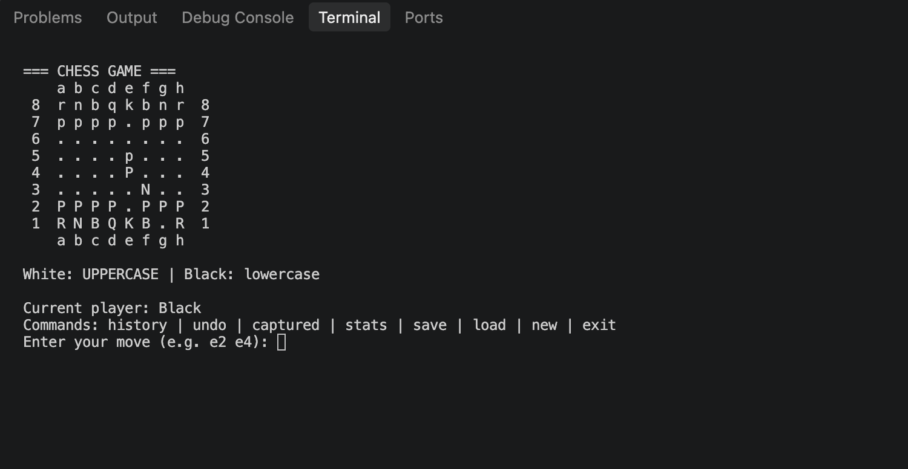

# ChessGame – C# Console Chess

A two-player, console-based chess game developed in **C# using the .NET platform**.

This project was created to strengthen my programming skills through the implementation of chess rules, move validation, game state management, and file-based persistence.

## Features

- **Interactive Chessboard** – An 8×8 board displayed in the terminal.
- **Two-Player Gameplay** – Local gameplay with alternating turns.
- **Move Validation** – Validates movement rules for each chess piece.
- **King Safety** – Prevents moves that would leave the player's king in check.
- **Check and Checkmate Detection** – Identifies when a king is under attack and when no legal moves remain.
- **Stalemate Detection** – Recognizes positions where a player has no legal moves but is not in check.
- **Move History** – Records previous moves.
- **Undo Functionality** – Restores the previous game state.
- **Captured Pieces** – Tracks captured pieces for both players.
- **Game Statistics** – Displays move counts, captures, and the current player.
- **Save and Load** – Saves and restores games using JSON serialization.

## Technologies Used

- C#
- .NET
- Visual Studio Code
- Git & GitHub
- System.Text.Json

## Getting Started

### Prerequisites

Install the [.NET SDK](https://dotnet.microsoft.com/download).

### Installation

Clone the repository:

```bash
git clone https://github.com/raczempeklajos/ChessGame.git
```

Navigate to the project directory:

```bash
cd ChessGame
```

Run the application:

```bash
dotnet run
```

## How to Play

The chessboard uses standard chess coordinates, from `a1` to `h8`.

Enter moves using the starting and destination squares separated by a space.

For example:

```text
e2 e4
e7 e5
g1 f3
```

White pieces are represented by uppercase letters, while black pieces use lowercase letters.

| Symbol | Chess Piece |
|---|---|
| K / k | King |
| Q / q | Queen |
| R / r | Rook |
| B / b | Bishop |
| N / n | Knight |
| P / p | Pawn |

## Available Commands

| Command | Description |
|---|---|
| `history` | Display move history |
| `undo` | Undo the last move |
| `captured` | Display captured pieces |
| `stats` | Show game statistics |
| `save` | Save the current game to JSON |
| `load` | Load a previously saved game |
| `new` | Start a new game |
| `exit` | Exit the application |

## Project Structure

```text
ChessGame/
├── Program.cs
├── ChessGame.csproj
├── .gitignore
└── README.md
```
## Game Preview



## Future Improvements

- Implement castling
- Implement en passant
- Implement pawn promotion
- Add a computer opponent using chess AI
- Implement additional draw conditions
- Improve the user interface
- Add automated tests

## What I Learned

Developing this project has helped me practice:

- C# programming and control flow
- Multidimensional arrays and collections
- Implementing rule-based algorithms
- Managing and restoring application state
- JSON serialization and file handling
- Version control with Git and GitHub

## Project Status

**In Development**

The application currently supports local two-player gameplay and the main chess movement rules. Special moves and additional game rules are planned for future versions.